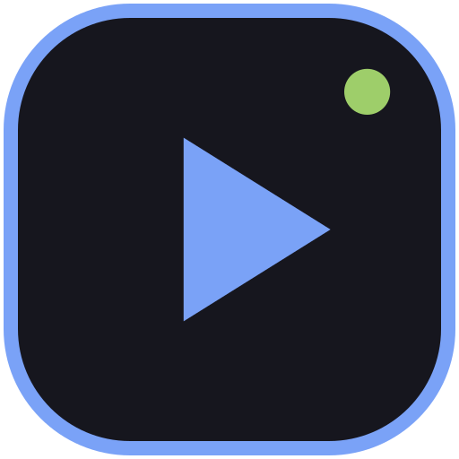

<p align="center">
  
</p>

<h1 align="center">Liosvideo</h1>

<p align="center">
  <strong>Deterministic, code-first video creation engine powered by WebGPU, Web Audio, and WebCodecs, built for pair-programming with AI coding agents.</strong>
</p>

<p align="center">
  <a href="https://github.com/ibrahimhnif/liosvideo/releases/latest"></a>
  <a href="https://github.com/ibrahimhnif/liosvideo/actions/workflows/ci.yml"></a>
</p>

<p align="center">
  <a href="#download">Download</a> •
  <a href="#key-features">Features</a> •
  <a href="#getting-started">Getting Started</a> •
  <a href="#agent-guidance">Agent Guidance</a> •
  <a href="#custom-skills">Custom Skills</a> •
  <a href="#license">License</a>
</p>

---

## Overview

**Liosvideo** turns technical video production into a software engineering workflow. Instead of clicking around a timeline in a traditional GUI video editor, videos are authored as pure, deterministic TypeScript code.

An AI coding agent (Claude Code, Gemini CLI, Codex, Antigravity, or custom ACP agents) researches topics, writes scripts, builds scenes, creates realistic mockups, coordinates speech narration, and refines animations. The desktop app provides a live hot-reloading WebGPU preview, synchronized audio playback, scrubbable multi-track timeline, visual diff verification, and hardware-accelerated MP4 export.

---

## Download

Download the latest desktop release for your platform. Installers are published automatically by CI for every `v*` tag.

<!-- downloads:start -->
Latest release: [`v0.1.0`](https://github.com/ibrahimhnif/liosvideo/releases/tag/v0.1.0) · [All releases](https://github.com/ibrahimhnif/liosvideo/releases)

_No installers have been published for this release yet._
<!-- downloads:end -->

> On macOS, drag `Liosvideo.app` into `/Applications`. On Windows, run the `.msi` or `-setup.exe` installer. On Linux, use the `.AppImage` (make it executable) or install the `.deb`.

See the [latest release](https://github.com/ibrahimhnif/liosvideo/releases/latest) for release notes and all available assets.

---

## Key Features

- **Pure Deterministic Runtime (`@liosvideo/runtime`)**:
  - Declarative scene graph with nested transforms, anchors, clipping, opacity, blur, custom shaders, and easing curves.
  - Seeking to any frame produces the exact same pixels as real-time playback.
  - Built-in transitions: `fade`, `slide`, `zoom`, `wipe`, and custom transition callbacks.
  - Built-in `logoMark(name, size, x, y)` helper with Tokyo Night palette for branding & channel openers.
- **Pixel-Perfect Realistic Mockups**:
  - Built-in components: macOS `desktop`, `window`, `chrome`, `terminal`, `editor` (VS Code style), `cursor`, `focus()` depth-of-field, and `phone` (9:16 mobile frame).
- **ACP (Agent Client Protocol) & Editor MCP Server**:
  - Connects to any ACP agent installed on your machine.
  - Embedded MCP server provides tools to inspect project state, capture rendered frames (`render_frame`), evaluate timelines, and synthesize narration.
  - Interactive chat stream cards for permissions, asset requests, and voice lines.
- **Persistent Git-Tracked History & Chat Sessions**:
  - Conversation history with AI agents is automatically stored in the project repository and persists across reloads.
  - Git checkpoints commit changes at the end of every agent turn and recording take.
  - Visual diff viewer and lossless "Restore to here" checkpointing.
  - Out-of-scope revision warning banner with one-click revert.
- **Cost & Usage Tracing**:
  - Real-time cost tracing dialog for TTS audio generation (character counting & provider pricing).
  - LLM token consumption tracking (input, output, and estimated USD total cost).
- **Asset Attachment & Image Ingestion**:
  - Drag-and-drop, clipboard paste, or file upload directly into the chat composer.
  - Images are automatically organized in `assets/images/` and ready for scene integration.
- **Narration & Speech Synchronization**:
  - Word-level audio alignment synchronization with `vo(id).wordTime(...)`.
  - Multi-provider TTS: ElevenLabs (live cloud, multilingual, and custom voice clones) & Google Cloud TTS (Bahasa Indonesia Neural2/Wavenet, Journey voices).
  - In-app microphone voice recording with live waveform and take management.
  - Secure API key storage via macOS Keychain (`/usr/bin/security`).
- **Hardware-Accelerated MP4 Export**:
  - Offline frame rendering with WebCodecs H.264 video encoding.
  - Web Audio `OfflineAudioContext` mixdown with AAC encoding and `mp4-muxer`.
  - Presets for 1080p, 4K, and 9:16 vertical shorts/reels.
- **Modern & Responsive Desktop UI**:
  - Svelte 5 and Tauri 2 architecture.
  - Draggable, resizable sidebar with persistent width settings.
  - Uniform vector iconography powered by `@lucide/svelte`.

---

## Repository Structure

```
├── apps/
│   └── desktop/            # Tauri 2 + Svelte 5 desktop application
│       ├── src/            # Svelte frontend UI (preview, timeline, chat, export, settings)
│       └── src-tauri/      # Rust backend (ACP client, MCP server, git, TTS, keychain)
├── packages/
│   └── runtime/            # @liosvideo/runtime declarative TypeScript video engine
├── skills/
│   └── liosvideo/          # Universal ACP agent skill & director guide
├── AGENTS.md               # Universal guidance for AI coding agents
└── LICENSE                 # MIT License
```

---

## Getting Started

### Prerequisites

- **macOS** (Apple Silicon recommended)
- **Node.js** >= 20 and **pnpm** >= 9
- **Rust** >= 1.80

### Installation

```bash
# Clone the repository
git clone https://github.com/ibrahimhnif/liosvideo.git
cd liosvideo

# Install dependencies
pnpm install

# Run unit and browser tests
pnpm test
pnpm --filter desktop test:browser
```

### Running Desktop in Development

```bash
# Start the desktop application in development mode
pnpm --filter desktop tauri dev
```

---

## Agent Guidance

Liosvideo includes universal agent guidance and skills designed to pair program with ACP agents out-of-the-box:

- See [`AGENTS.md`](./AGENTS.md) for the complete developer and agent reference.
- See [`skills/liosvideo/SKILL.md`](./skills/liosvideo/SKILL.md) for the master video director skill.

---

## Custom Skills

You can establish consistent styles, palettes, character animations, or company brand guidelines by creating custom skills:

1. Add your custom skill under `.agents/skills/<skill-name>/SKILL.md` (project-level) or `skills/<skill-name>/SKILL.md` (repository-level).
2. Define preferred typography, layout rules, reusable helper functions (e.g. `logoMark`), and voice choices.
3. Your ACP agent will automatically load and adhere to the skill instructions when generating or revising scenes.

---

## License

This project is licensed under the [MIT License](./LICENSE).
